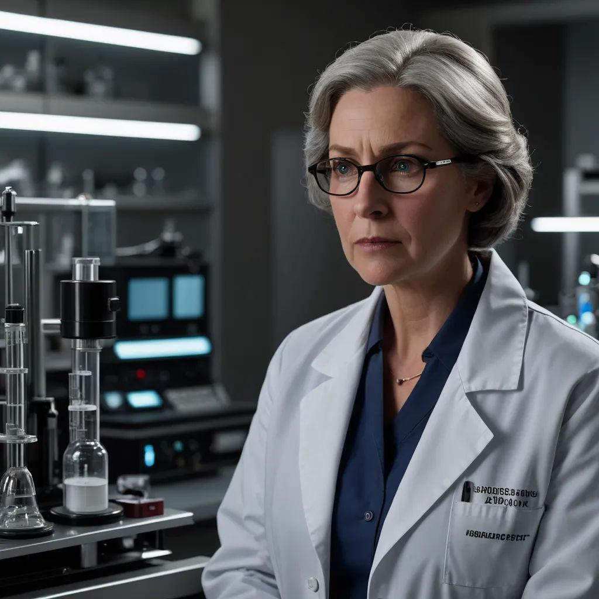

# Dr. Élodie Vasseur

*Director of Research*

In [[Session 9 - The Doctor's Bargain]], staff records identify Vassar as research chief of the [[Free Arden Research Facility]]. Her age and CV suggest involvement in the original advanced-clone program, though the party does not personally interview her.

Her doctoral research explored changing genetic code within living hosts without ordinary direct intervention, including aerosol or drug-mediated approaches. Her work is relevant to [[Psychic Clone Conspiracy]], but her own psychic status and exact role in particular crimes are not established. No first name is supplied.

:::gm
## Original GM Profile

**Role:** Director of Research | **Age:** 54 | **Species:** Human.

Precise, impatient, and proud of her work. She believes classified research protects the continuity program. The original preparation says she authorized genetic-delivery production without knowing it would be used on children. She can supply manufacturing records, contracts, and information about the restricted division. Her full knowledge must be reconciled with later played evidence.

**Suggested Traveller skills:** Science (Genetics) 4, Medic 2, Admin 2, Leadership 2.

[Original NPC roster and portrait reference](https://chatgpt.com/share/6ae9618b-db80-83e9-81a0-52db2a7563d4). These are preparation details; played events take precedence, and unplayed secrets are not player discoveries.
:::

