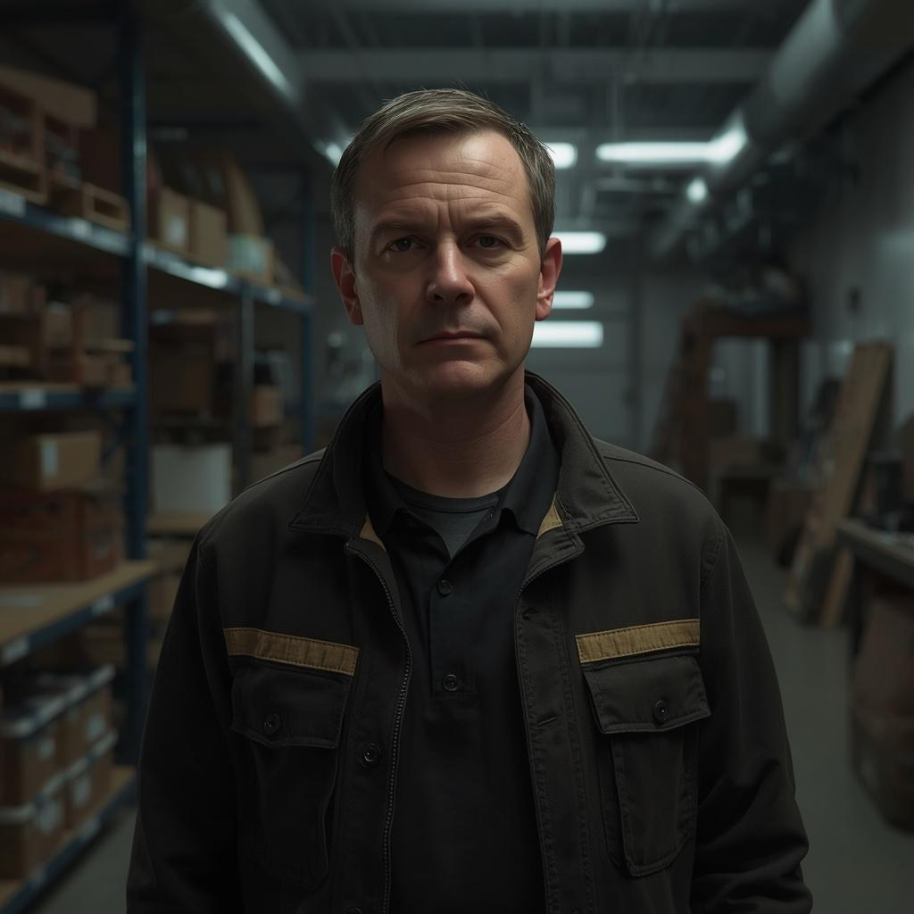

# Étienne Roussel

*Logistics Supervisor*

This character belongs to the original [[Free Arden Research Facility]] cast. The crew has not identified or encountered this individual in [[Session 9 - The Doctor's Bargain]].

:::gm
## Original GM Profile

**Role:** Logistics Supervisor | **Age:** 45 | **Species:** Human.

Gregarious, opportunistic, and discreet. He notices supplies exceeding the restricted division's budget. Some shipments use companies linked to Marcel Delphine; he thinks he is hiding smuggling rather than genetic manipulation. He can provide routes, ship identities, cargo volumes, and recipients. He was not identified or encountered in Game 9.

**Suggested Traveller skills:** Broker 2, Admin 2, Electronics (Sensors) 1, Streetwise 2, Mechanic 1.

[Original NPC roster and portrait reference](https://chatgpt.com/share/6ae9618b-db80-83e9-81a0-52db2a7563d4). These are preparation details; played events take precedence, and unplayed secrets are not player discoveries.
:::
