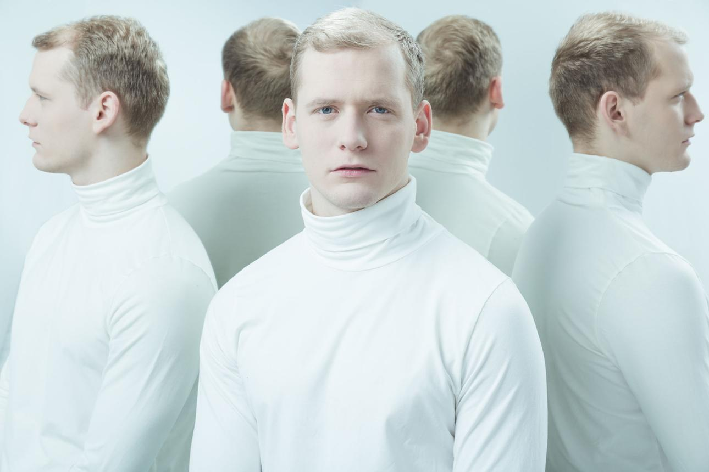

# Julien Arnaud, Subject D-114

*Continuity Subject*

This character belongs to the original [[Free Arden Research Facility]] cast. The crew has not identified or encountered this individual in [[Session 9 - The Doctor's Bargain]].

:::gm
## Original GM Profile

**Role:** Continuity Subject | **Age:** 29 (apparent) | **Species:** Human clone.

Apparent age 29. He believes he is recovering from neurological injuries after a transport accident. His memories are incomplete and include disturbing fragments. His original is still alive as a government economic adviser. He is proposed as a living duplicate with valuable political memories and an extraction dilemma. He was not identified or rescued in Game 9.

**Suggested Traveller skills:** Admin 2, Diplomat 1, Computers 1, Profession (Economics) 2.

[Original NPC roster and portrait reference](https://chatgpt.com/share/6ae9618b-db80-83e9-81a0-52db2a7563d4). These are preparation details; played events take precedence, and unplayed secrets are not player discoveries.
:::
