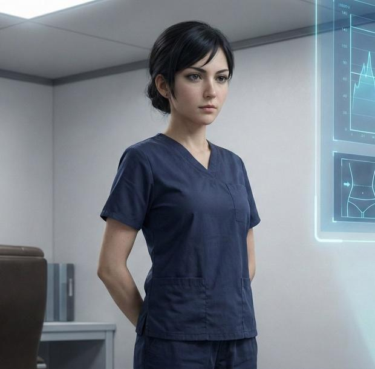

# Mireille Fournier

*Senior Medical Technician*

Staff information in [[Session 9 - The Doctor's Bargain]] identifies Fournier as the resident caretaker/nurse at the [[Free Arden Research Facility]]. She feeds subjects, oversees waking clones, and has access to living people who are not fully coherent.

The original roster confirms Mireille Fournier; Mariel Fonter is a transcript rendering. The party does not meet her, extract her, or determine her fate during the later containment release. Her exact knowledge of each political manipulation is not demonstrated.

:::gm
## Original GM Profile

**Role:** Senior Medical Technician | **Age:** 38 | **Species:** Human.

Compassionate, practical, and stubborn. The original preparation says she secretly helped two clone subjects contact the outside and knows about undocumented patient transfers. She can identify restricted wards, disappearing patients, and transport practices. Game 9 establishes her caretaker role through records, not a personal meeting or confirmed rescue.

**Suggested Traveller skills:** Medic 3, Science (Biology) 1, Persuade 1, Stealth 1.

[Original NPC roster and portrait reference](https://chatgpt.com/share/6ae9618b-db80-83e9-81a0-52db2a7563d4). These are preparation details; played events take precedence, and unplayed secrets are not player discoveries.
:::

