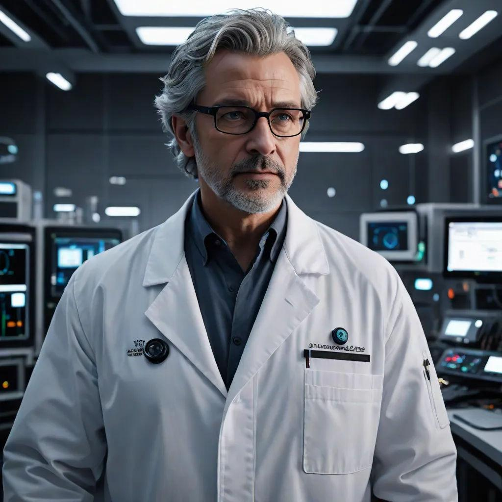

# Professor Lucien Moreau

*Director of Special Projects*

In [[Session 9 - The Doctor's Bargain]], Cass encounters this silver-haired scientist after a failed Stealth approach in the [[Free Arden Research Facility]]. Cass claims to be newly arrived Dr. Penn. Moreau accepts the story, rebukes [[Claire Montfort]] for missing administrative support, and directs the party to the staff quarters.

Moreau describes tension between research and administrative deadlines and says he comes to this service area to use Bioforce when down or tired. The original roster confirms his first name as Lucien and identifies him as Director of Special Projects; his full involvement remains in the GM profile.

The party subsequently finds titanium frames matching his spectacles in a warm incinerator. Records explain that researchers make rushed copies of themselves to meet deadlines and incinerate the failing bodies. The clue suggests a copy, but the exact body is not independently identified.

This character is not merged with [[Dr. Luc Moreau]], the Hall scientist from Game 2: the transcript does not establish they are the same person.

:::gm
## Original GM Profile

**Role:** Director of Special Projects | **Age:** 61 | **Species:** Human.

Charming, arrogant, and convinced he is saving Solomani society. The original preparation makes him an architect of the illegal program, aware of living duplicates and psychic work. Some changes are intended to produce useful inherited traits rather than immediate blackmail. He understands the shortage of Krypton-derived stabilizer. His full role was not revealed by his friendly conversation with Cass.

**Suggested Traveller skills:** Science (Genetics) 5, Science (Psionicology) 2, Medic 2, Persuade 2, Admin 2.

[Original NPC roster and portrait reference](https://chatgpt.com/share/6ae9618b-db80-83e9-81a0-52db2a7563d4). These are preparation details; played events take precedence, and unplayed secrets are not player discoveries.
:::

