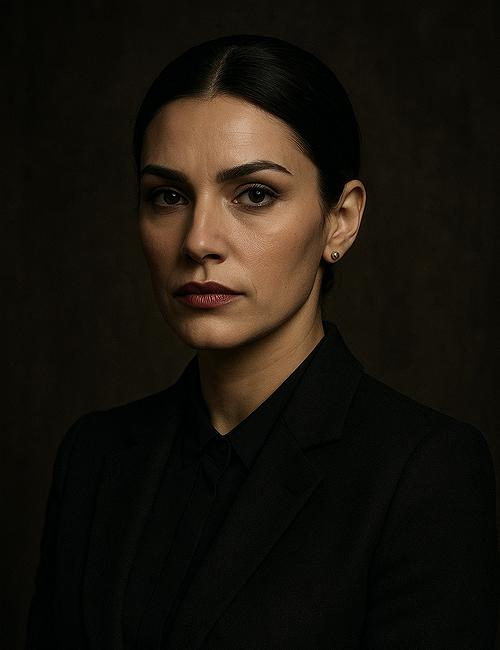

# Sabine Delacroix

*Special Assessment Officer*

In [[Session 9 - The Doctor's Bargain]], the crew finds explicit documentation that Delacroix has psychic abilities and trains other subjects at the [[Free Arden Research Facility]]. Recorded demonstrations include moving an anvil telekinetically.

The original roster confirms Sabine Delacroix; Sabine Delaroy is a transcript alias. She is affiliated with [[Social Solidarity]]. She did not possess these powers during her original training; the records indicate later alteration or replacement. The party cannot determine whether she is an altered original or a modified copy. She is not directly encountered or identified as the phase-shifting sword user.

She is separate from [[Sabine Caron]], Profondeur's security/diving specialist.

:::gm
## Original GM Profile

**Role:** Special Assessment Officer | **Age:** 36 (apparent) | **Species:** Human.

Apparent age 36. The original preparation makes her a psychic replacement loyal to the splinter faction, quietly evaluating Zoy using Beaumont's proposed recruitment lure. She knows two recruiters of compromised SolSec officers. In Game 9 the party discovers explicit psychic-training records, but cannot tell whether she is an altered original or a replacement; her replacement status remains a GM secret. Her listed powers do not prove she is the unidentified sword user.

**Suggested Traveller skills:** Investigate 2, Deception 2, Medic 1, Persuade 2; Telepathy 2, Awareness 1; suggested PSI 10.

[Original NPC roster and portrait reference](https://chatgpt.com/share/6ae9618b-db80-83e9-81a0-52db2a7563d4). These are preparation details; played events take precedence, and unplayed secrets are not player discoveries.
:::

